# 🚀 Awesome Command Line Interface (CLI) Test Runner (Newman)

  
  
  
  
  

  <strong>A curated directory of CLI test runners, Newman ecosystems, headless API test frameworks, and distributed load testing tools for modern CI/CD automation pipelines.</strong>

---

## 📑 Table of Contents
- [📖 Overview & SEO Summary](#-overview--seo-summary)
- [📊 Sector Overview & Market Dynamics](#-sector-overview--market-dynamics)
- [☁️ SaaS / Hosted Test Platforms](#️-saas--hosted-test-platforms)
- [🛠️ Open-Source GitHub Projects](#️-open-source-github-projects)
- [📈 Star History](#-star-history)
- [🤝 How to Contribute](#-how-to-contribute)
- [💖 Support & Sponsorship](#-support--sponsorship)
- [⚖️ Disclaimer](#️-disclaimer)

---

## 📖 Overview & SEO Summary

Automated testing directly in the terminal—without launching graphical browsers or desktop apps—is fundamental to rapid deployment feedback loops and headless continuous integration (CI/CD) pipelines. This repository catalogs both commercial cloud services and open-source command line interface (CLI) test execution utilities.

Whether you run **Postman collections** using **Newman**, conduct distributed API stress tests with **k6** or **Vegeta**, assert HTTP contract responses with lightweight tools like **Hurl** and **HTTPie**, or execute cross-browser end-to-end tests via **Playwright** and **Cypress**, this guide indexes the entire CLI test automation ecosystem.

---

## 📊 Sector Overview & Market Dynamics

The global **API testing and automated performance testing market** is currently estimated at **$4.4B – $5.0B** (projected to reach over **$10B+ by 2032** at an annual CAGR of ~15–20%), driven by microservices sprawl, cloud-native deployments, and shift-left DevSecOps automation. 

In terms of structure, the sector is **moderately fragmented yet consolidated at the top**: grassroots, developer-first open-source CLI tools (such as Newman, k6, Hurl, and Playwright) dominate everyday developer workflows and CI scripts, whereas enterprise-wide contracts and centralized SaaS orchestration dashboards remain heavily concentrated among a few dominant industry leaders like Postman, Grafana Labs, SmartBear, and Tricentis.

---

## ☁️ SaaS / Hosted Test Platforms

The table below lists leading commercial/hosted platforms offering dedicated CLI runners and cloud-managed dashboards, sorted in descending order by enterprise valuation / company scale.

| Product | Valuation / Scale | Pricing (Starting Tier) | Free Tier / Trial Limits | Description |
|---|---|---|---|---|
| **[k6 (Grafana Cloud)](https://k6.io/)** | **~$9B Valuation** (Grafana Labs Series E; $400M+ ARR) | Grafana Cloud k6 Pro starts at **$19/month** (includes 500 VU-hours; $0.15/VU-hour overage) | **Free forever plan**: 500 virtual user hours (VUH)/month, max 50 concurrent virtual users (VUs), 1 concurrent test, and 30-day data retention. | Cloud-managed load testing platform powered by the k6 engine, offering distributed load generation and web dashboards. |
| **[Postman (CLI + Platform)](https://www.postman.com/)** | **~$5.6B Valuation** ($313M+ estimated ARR) | Solo plan starts at **$9/month** billed annually ($12 billed monthly); Team plan starts at **$19/user/month** | **Free forever plan**: Single user only, unlimited collection runs, 1,000 monitoring requests/month, unlimited mock server calls up to 120k requests/year, 50 AI credits/month. | Full API development and testing platform encompassing CLI runs, API monitors, mock servers, and workspaces. |
| **[Postman CLI](https://www.postman.com/)** | **~$5.6B Valuation** ($313M+ estimated ARR) | **$0** (Included with Postman account; paid plans start at **$9/month** Solo or **$19/user/month** Team) | **Free forever plan**: Single user only, unlimited collection runs, 1,000 monitoring requests/month, 50 AI credits/month. No team workspaces on free tier. | Official CLI for Postman to run collections, monitors, and governance checks directly from CI/CD pipelines. |
| **[Cypress Cloud](https://www.cypress.io/)** | **~$255M Valuation** (~$18M ARR; $63M funding raised) | Team plan starts at **$67/month** (Business plan starts at **$267/month**) | **Free forever plan (Starter)**: 500 test results/month, max 10 user seats, and 30-day data retention. (14-day free trial available for Smart Orchestration). | Cloud test orchestration, parallelization, flake detection, and analytics service for Cypress CLI test suites. |
| **[Artillery (Cloud)](https://www.artillery.io/)** | **~$2.1M Seed Funded** (YC backed; ~$1M ARR) | Team plan starts at **$199/month** (annual discount available; Business at $499/month) | **Free forever plan**: 30 test reports/month, max 2 team members, 5 distributed workers per test, 25 E2E cases per report, 1-month retention. | Cloud platform and dashboard for Artillery load testing and Playwright-based end-to-end performance tests. |

---

## 🛠️ Open-Source GitHub Projects

A comprehensive index of open-source CLI test runners, HTTP assertion tools, and load testing utilities, strictly sorted in descending order by GitHub stargazer count.

| Project | Stars | Language | Primary Focus | Description |
|---|:---:|---|---|---|
| **[Playwright](https://github.com/microsoft/playwright)** |  | TypeScript / C++ / Python | E2E Browser & API Testing | Microsoft's modern automation library and CLI runner for Chromium, Firefox, and WebKit with native API request testing, sharding, and trace viewing. |
| **[Cypress](https://github.com/cypress-io/cypress)** |  | JavaScript / TypeScript | E2E Web & Component Testing | Fast, easy, and reliable headless browser testing CLI for anything that runs in a browser. Built with automatic waiting, network stubbing, and time-travel snapshots. |
| **[HTTPie CLI](https://github.com/httpie/cli)** |  | Python | HTTP API Client & Testing | Modern, user-friendly command-line HTTP client. Features formatted syntax highlighting, intuitive JSON payload syntax, persistent sessions, and CI integration. |
| **[k6](https://github.com/grafana/k6)** |  | Go / JavaScript | Load & Performance Testing | Modern developer-centric load testing tool built in Go with JavaScript test scripting. Executes high-volume concurrent virtual users directly from CLI. |
| **[Locust](https://github.com/locustio/locust)** |  | Python | Load & Stress Testing | Scalable user load testing tool for web APIs and microservices. Define user behavior directly in standard Python code and drive headless tests via CLI. |
| **[Vegeta](https://github.com/tsenart/vegeta)** |  | Go | HTTP Load & Benchmarking | Ultra-fast, versatile HTTP load testing tool and library. Designed to drill HTTP services with constant request rates from a standalone CLI binary. |
| **[Hey](https://github.com/rakyll/hey)** |  | Go | HTTP Load Benchmarking | Lightweight, fast CLI load generator and ApacheBench replacement written in Go. Generates instant response time histograms and latency percentiles. |
| **[Hurl](https://github.com/Orange-OpenSource/hurl)** |  | Rust | Plain-Text HTTP Assertions | Run and test HTTP requests defined in simple, human-readable plain text. Single fast Rust binary powered by libcurl with support for JSONPath, XPath, and CI pipeline reports. |
| **[Artillery (OSS)](https://github.com/artilleryio/artillery)** |  | TypeScript / Node.js | Load & E2E Stress Testing | Cloud-scale load testing and smoke testing framework. Supports HTTP, WebSocket, Socket.io, gRPC, and browser-driven Playwright performance runs. |
| **[Newman](https://github.com/postmanlabs/newman)** |  | JavaScript / Node.js | Postman Collection Runner | Official command-line collection runner for Postman. Allows developers to run and test Postman collections directly from CI/CD systems without GUI dependencies. |
| **[Gatling](https://github.com/gatling/gatling)** |  | Scala / Java / Kotlin | Enterprise Load Testing | Asynchronous, non-blocking high-performance load testing engine with CLI support and rich HTML metrics generation. |
| **[Dredd](https://github.com/apiaryio/dredd)** |  | JavaScript / Python / Go | API Contract Testing | Language-agnostic HTTP API testing tool that validates live backend API endpoints against OpenAPI 3.0/3.1 and API Blueprint specifications. |
| **[Schemathesis](https://github.com/schemathesis/schemathesis)** |  | Python / Rust | Property-Based API Testing | Specification-based testing tool that automatically generates test cases from OpenAPI / GraphQL schemas to find edge-case crashes and contract bugs. |
| **[Tavern](https://github.com/taverntesting/tavern)** |  | Python | YAML-Driven API Testing | Command-line tool and pytest plugin for automated testing of RESTful APIs and MQTT/gRPC endpoints using simple, declarative YAML configuration files. |

---

## 📈 Star History

---

## 🤝 How to Contribute

Contributions are warmly welcome! Help make this the most complete resource for command-line testing tools:

1. 🍴 **Fork** the repository.
2. 🌿 Create a descriptive feature branch (`git checkout -b feature/add-runner`).
3. ✏️ Add or update entries following the alphabetical / star-sorted tabular schema.
4. 🔗 Ensure all links, badges, and documentation links are accurate and functional.
5. 🚀 Submit a **Pull Request** with a concise description of your additions.

---

## 💖 Support & Sponsorship

If you find this curated directory helpful for your testing stacks, CI/CD pipelines, or developer workflow, please consider supporting the project:

- ⭐ **Star** this repository on GitHub to boost visibility.
- 🍴 **Fork** and share it with your engineering and QA teams.
- ☕ **Buy a Coffee / Sponsor**: Show extra love by sponsoring via the [GitHub Sponsor Dashboard](https://github.com/sponsors/ishandutta2007).

Your support motivates continuous updates and ecosystem curation!

---

## ⚖️ Disclaimer

- This is a **community-curated** list intended solely for informational, educational, and developer reference purposes; inclusion does not constitute a commercial endorsement.
- CLI test runners execute real network traffic and HTTP/TCP calls—always configure tests against isolated staging environments, sanitize test databases, and manage API secrets responsibly.
- Company valuations and pricing tiers reflect published industry metrics as of 2026; verify specific tier limits with respective vendor documentation before enterprise purchasing.

---

  Maintained with ❤️ by <a href="https://github.com/ishandutta2007">Ishan Dutta</a> and the open-source testing community.

